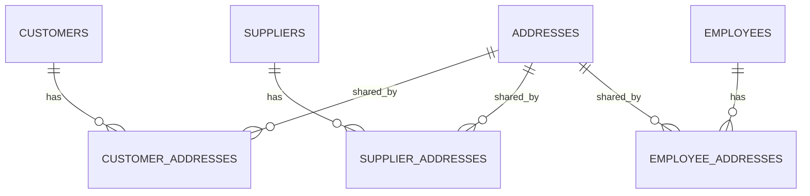

# DB DOCS — Database Architecture & Schema

## Overview

This directory is the reference for the implemented database schema. It documents only entities that already exist as SQLAlchemy models and Alembic migrations, and that are covered by tests, per [ADR 0006](../adr/0006-incremental-table-by-table-modeling-instead-of-full-upfront-er-design.md).

| File                           | Description                                                                 |
| ------------------------------ | --------------------------------------------------------------------------- |
| [`schema.json`](./schema.json) | ChartDB native save/export. It must be produced by ChartDB, not edited by hand. |
| [`schema.sql`](./schema.sql)   | Schema-only PostgreSQL dump of the implemented database.                    |
| [`README.md`](./README.md)     | This document: tables, relationships, constraints, and business rules.      |

> **ChartDB export status (2026-11-03):** `schema.json` is the ER model's save file and is generated by ChartDB. The copy in this repository was last exported on 2026-09-18, still contains pre-implementation draft tables (`purchases`, `purchase_items`, `sales`, `sale_items`, `inventory`), and omits the address tables. It is pending a re-export. Do not hand-edit it. Use `schema.sql` and this README as the current textual reference until the ChartDB export is refreshed. Remove this note once `schema.json` is regenerated.

---

## Current schema

Alembic head at the time of this snapshot: `c4f8a1d2b6e3`.

### Tables (summary)

| Table                | Purpose                                      | Key columns                                                                 |
| -------------------- | -------------------------------------------- | --------------------------------------------------------------------------- |
| `employees`          | Bakery staff and system identities           | `id`, `username`, `password`, `birth_date`, `hire_date`, `active`           |
| `customers`          | People or companies that buy from the bakery | `id`, `first_name`, `last_name`, `company_name`, `is_company`, `active`     |
| `suppliers`          | People or companies that supply the bakery   | `id`, `rfc`, `company_name`, `provide_invoice`, `lead_time_days`, `active`  |
| `addresses`          | Shared physical locations                    | `id`, `street`, `exterior_number`, `neighborhood`, `city`, `postal_code`    |
| `customer_addresses` | Links customers to shared addresses          | `customer_id`, `address_id`, `is_default`, `is_billing`, `active`           |
| `supplier_addresses` | Links suppliers to shared addresses          | `supplier_id`, `address_id`, `is_default`, `is_billing`, `active`           |
| `employee_addresses` | Links employees to shared addresses          | `employee_id`, `address_id`, `is_default`, `active`                         |

`employees`, `customers`, `suppliers`, and `addresses` use UUID primary keys generated by PostgreSQL (`gen_random_uuid()`). `alembic_version` is Alembic's internal bookkeeping table and is included in `schema.sql` only for completeness.

### Common columns

- `employees`, `customers`, and `suppliers` reuse the `PersonMixin` fields: `id`, `first_name`, `last_name`, `phone_number`, `email`, `created_at`, `updated_at`.
- `addresses` uses `UUIDMixin` and `TimestampMixin`: `id`, `created_at`, `updated_at`.
- `created_at` is `timestamptz NOT NULL DEFAULT now()`.
- `updated_at` is `timestamptz NULL` and is maintained by SQLAlchemy's `onupdate`.

### Table notes

#### `employees`

Includes the system-generated `username`, the bcrypt `password` hash, `birth_date`, lifecycle fields `hire_date` and `termination_date`, `active`, and the audit fields `last_login_at` and `last_password_change_at`. The plaintext password and password hash are intentionally absent from API read schemas. See [ADR 0007](../adr/0007-employee-identity-credentials-and-lifecycle.md).

#### `customers` and `suppliers`

Both have `active`, `activated_at`, and `deactivated_at` for soft-delete/activation flows. `customers` add `company_name` and `is_company`. `suppliers` add `rfc`, `company_name`, `is_company`, `provide_invoice`, `lead_time_days`, and `minimum_order_value`.

Supplier check constraints:

- `rfc` length must be between 12 and 13 characters (nullable).
- `lead_time_days >= 0`.
- `minimum_order_value >= 0`.

#### `addresses`

Describes only a physical location. It has **no owner column** and no role-specific flags. The same address row can be linked to any number of customers, suppliers, and employees, per [ADR 0008](../adr/0008-shared-addresses-with-per-role-link-tables.md).

`latitude` and `longitude` are nullable `numeric(10,8)` / `numeric(11,8)` values.

#### Address link tables

`customer_addresses`, `supplier_addresses`, and `employee_addresses` use a composite primary key `(subject_id, address_id)`, which prevents linking the same address twice to the same subject.

Role-specific flags:

- `customer_addresses`: `is_default`, `is_billing`
- `supplier_addresses`: `is_default`, `is_billing`
- `employee_addresses`: `is_default` only. `is_billing` was removed by migration `e423c02db1c6`; employee addresses are not billing addresses.

All three link tables also carry lifecycle fields: `active`, `activated_at`, and `deactivated_at`.

---

## Relationships & constraints

### Entity relationship diagram

### Primary keys

| Table                | Primary key                     |
| -------------------- | ------------------------------- |
| `employees`          | `id`                            |
| `customers`          | `id`                            |
| `suppliers`          | `id`                            |
| `addresses`          | `id`                            |
| `customer_addresses` | `(customer_id, address_id)`     |
| `supplier_addresses` | `(supplier_id, address_id)`     |
| `employee_addresses` | `(employee_id, address_id)`     |

### Foreign keys

| Link table           | Subject FK                                          | Address FK                                              |
| -------------------- | --------------------------------------------------- | ------------------------------------------------------- |
| `customer_addresses` | `customer_id → customers.id` `ON DELETE CASCADE`    | `address_id → addresses.id` `ON DELETE RESTRICT`        |
| `supplier_addresses` | `supplier_id → suppliers.id` `ON DELETE CASCADE`    | `address_id → addresses.id` `ON DELETE RESTRICT`        |
| `employee_addresses` | `employee_id → employees.id` `ON DELETE CASCADE`    | `address_id → addresses.id` `ON DELETE RESTRICT`        |

`ON DELETE CASCADE` means deleting a subject removes its link rows. `ON DELETE RESTRICT` means an address that is still linked to any subject cannot be deleted.

### Unique constraints and indexes

- `employees.username` is unique.
- Each link table has a partial unique index enforcing at most one default address per subject:
  - `uq_customer_addresses_one_default` on `customer_addresses(customer_id) WHERE is_default = true`
  - `uq_supplier_addresses_one_default` on `supplier_addresses(supplier_id) WHERE is_default = true`
  - `uq_employee_addresses_one_default` on `employee_addresses(employee_id) WHERE is_default = true`
- Each link table has an index on `address_id`: `ix_customer_addresses_address_id`, `ix_supplier_addresses_address_id`, `ix_employee_addresses_address_id`.

### Checks and validation notes

- Supplier RFC format is validated at the API level with `^[A-ZÑ&]{3,4}\d{6}[A-Z0-9]{3}$`; the database only enforces length 12–13.
- Supplier `lead_time_days` and `minimum_order_value` must be non-negative.
- Address latitude/longitude are optional.

---

## Business rules

### One default address per subject

A customer, supplier, or employee can have several addresses, but at most one with `is_default = true`. The partial unique index enforces this in the database; the CRUD layer clears the previous default before setting a new one.

### Address deletion is a soft delete of the link

`DELETE /{role}/{id}/addresses/{address_id}` does **not** delete the row in `addresses`. It deactivates the link:

- `active = false`
- `deactivated_at = today`
- `is_default = false`
- `is_billing = false` for customers and suppliers

The `addresses` row is kept. This can leave an orphan address row when no subject links to it anymore; a cleanup policy is deferred, per ADR 0008.

### Shared addresses

Editing an address changes it for every customer, supplier, or employee linked to it. To move one subject to a different physical location, create a new address and link it instead of editing the shared row.

### Roles and flags

- `is_billing` exists only on customer and supplier links.
- Employee addresses have no billing flag.
- `active` on customers, suppliers, employees, and address links is the soft-delete state.

---

## Migration history

| Revision         | Purpose                                                        |
| ---------------- | -------------------------------------------------------------- |
| `2af7bf2bb8eb`   | Add `employees` table                                          |
| `0ec332773eda`   | Add `customers` table                                          |
| `934452af494a`   | Add `suppliers` table                                          |
| `ecf8796ecfcf`   | Add `addresses`; remove `minimum_order_quantity` from suppliers |
| `185f8f3e0439`   | Add `customer_addresses` link table                            |
| `de60a1718c77`   | Add `employee_addresses` link table                            |
| `055e0473608e`   | Add `supplier_addresses` link table                            |
| `8c918469fe20`   | Allow `latitude` and `longitude` to be nullable                |
| `e423c02db1c6`   | Remove `is_billing` from `employee_addresses`                  |
| `c4f8a1d2b6e3`   | Add lifecycle fields to address link tables                    |

---

## Maintaining `schema.json` (ChartDB)

`schema.json` is the native save/export file of the ER model. It is **not** a hand-written document and must not be edited directly.

When the database changes:

1. Apply the model and migration changes.
2. Regenerate `schema.sql` from the database (command in the file header).
3. Open ChartDB at <http://localhost:8080> while the dev stack is running.
4. Update the diagram so it matches the implemented tables, columns, constraints, and relationships.
5. Export the diagram as JSON and overwrite `docs/db/schema.json`.
6. Commit the updated `schema.json` together with the migration and README changes.

Until the pending ChartDB export is refreshed, treat `schema.sql`, the models, and the migrations as the current source of truth for schema details.

---

## Decisions and notes

- **Single source of truth:** schema documentation lives in `docs/db/` and is versioned through Git, per [ADR 0005](../adr/0005-single-source-of-truth-for-database-schema-documentation.md).
- **Incremental modeling:** tables are documented only after being implemented and tested, per [ADR 0006](../adr/0006-incremental-table-by-table-modeling-instead-of-full-upfront-er-design.md).
- **Shared addresses:** one address row can serve multiple roles; role-specific flags live in the link tables, per [ADR 0008](../adr/0008-shared-addresses-with-per-role-link-tables.md).
- **Migrations:** schema changes must always be made through Alembic; `schema.sql` is a snapshot, not an executable migration source.

---

Made by [armandx06](https://github.com/armandx06) at September 18, 2026. Updated November 3, 2026.
